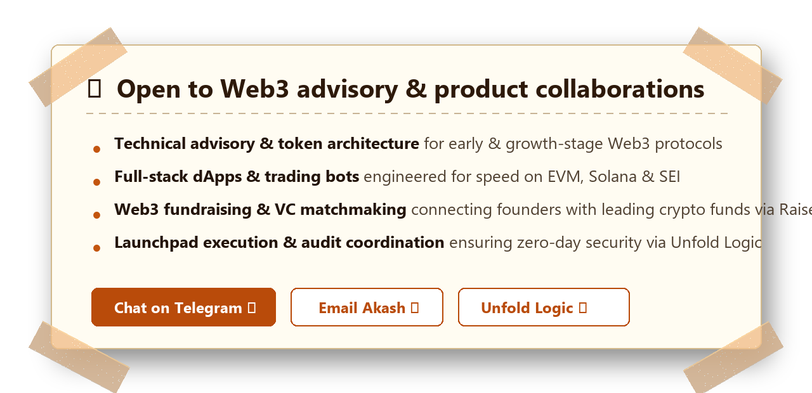

  

  

&nbsp;

 

&nbsp;

&nbsp;

&nbsp;

&nbsp;

&nbsp;

&nbsp;

&nbsp;

### Hi, I'm Akash! 👋

I'm a **Web2 + Web3 product builder, founder, and technical consultant** taking decentralized protocols and applications from idea → architecture → production — shipping real, production-grade products that people actually need rather than throwaway demos.

As founder of **[Unfold Logic](https://unfoldlogic.blog)**, I work with early-stage and high-growth Web3 teams across **token infrastructure, fundraising architecture, launchpads, auditing coordination, and high-performance trading systems**. If it touches a chain and has to survive real users and capital, that's my playground.

I also operate:
- **[RaiseEquity](https://raisequity.com)** — Web3 fundraising & investor matchmaking network connecting founders with active crypto VCs and angel syndicates.
- **[Hire in Crypto](https://hireincrypto.com)** — Web3 talent community & recruiting network for high-velocity blockchain ecosystems.
- **[YourWeb3Guy](https://yourweb3guy.com)** — In-depth research, tokenomic breakdowns, and market insights on [Substack](https://akashkumarjha.substack.com/).

Over the last 4+ years, I've shipped **17+ production dApps**, worked with **53+ startups** across EVM, Solana, and SEI (including **[Sei.fun](https://sei.fun)**, **BNC**, **GRX**, **ONESSUS**, **GameGPT**, and **SKL Trading**), and helped multiple founders navigate 7-figure token and equity raises.

 

&nbsp;

<!-- COLLABORATION NOTICE CARD -->

 

&nbsp;

&nbsp;

&nbsp;

<!-- FOCUS AREAS -->

<h3>FOCUS AREAS</h3>

<code>STRUCTURE</code> &nbsp;·&nbsp; <code>SHIP</code> &nbsp;·&nbsp; <code>SCALE</code>

### Token Infrastructure & Launchpads

Designing and shipping token launches — economics, vesting, launchpad flows, listing coordination — for teams that need to go from concept to live market.

### Web3 Fundraising & Investor Matching

Building the infrastructure (and the network) that helps founders raise: investor matchmaking via RaiseEquity, pitch material, and pipeline operations.

### dApp & Trading Systems

Solana, EVM, and app-chain dApps; Telegram/terminal trading bots; order flows; and chain-optimized product UX.

### Auditing & Security Support

Pre-launch security reviews, contract vetting, and audit coordination so products meet the bar before real funds are involved.

 

<!-- SKILLS & TOOLING -->

<strong>SKILLS &amp; TOOLING</strong>

 

<table>
<tr>
<td width="50%" valign="top">

<h3>WEB3</h3>

</td>
<td width="50%" valign="top">

<h3>WEB2</h3>

</td>
</tr>
<tr>
<td width="50%" valign="top">

<h3>PRODUCT &amp; GTM</h3>

</td>
<td width="50%" valign="top">

<h3>AI &amp; INFRA</h3>

</td>
</tr>
</table>

<!-- COMPANIES & PRODUCTS -->

<h3>COMPANIES &amp; PRODUCTS</h3>

| Product / Venture | What it is | Link |
|---|---|---|
| **Unfold Logic** | Web3 product studio & technical consultancy | [unfoldlogic.blog](https://unfoldlogic.blog) |
| **RaiseEquity** | Web3 fundraising & investor matchmaking platform | [raisequity.com](https://raisequity.com) |
| **Hire in Crypto** | Web3 hiring & talent community | [hireincrypto.com](https://hireincrypto.com) |
| **YourWeb3Guy** | Long-form research, writing & Web3 insights | [yourweb3guy.com](https://yourweb3guy.com) |

<!-- FLAGSHIP PROJECTS -->

<h3>FLAGSHIP PROJECTS</h3>

### Sei.fun — Memecoin Creation & Trading on SEI
Token launch & trading flows, chain-optimized UX, and infrastructure support for a production memecoin platform on **SEI Chain**.

### Raise.social — Crypto Crowdfunding on Solana
Wallet-based donations with on-chain transparency and tracking for a Solana crowdfunding platform.

### Thunder Trade — Telegram Crypto Trading Bot
Custom trading infrastructure with **Solana & EVM** support, built for speed and reliability.

### Roll Protocol — Memecoin Creation on EVM & Form Chain
Token creation pipelines, trading mechanics, and frontend integration on **EVM & Form Chain**.

**BNC** · **GRX** · **ONESSUS** · **SEI.fun** · **GameGPT** · **SKL Trading** — and **50+ more startups**

<!-- PROOF OF WORK -->

<h3>GITHUB PULSE</h3>

<h3>PROOF OF WORK</h3>

<!-- LATEST FROM THE BLOG -->

<h3>LATEST FROM THE BLOG</h3>

| # | Post | Link |
|---|---|---|
| 1 | The $250k Web3 job no one is talking about (and 35 others) | [Read →](https://akashkumarjha.substack.com/p/the-250k-web3-job-no-one-is-talking) |
| 2 | Everything I Know About Fundraising in Web3 | [Read →](https://akashkumarjha.substack.com/p/everything-i-know-about-fundraising) |
| 3 | Get into $400 Billions Opportunity before anyone else in Web3 | [Read →](https://akashkumarjha.substack.com/p/get-into-400-billions-opprtunity) |
| 4 | 27 Web3 Jobs You Can Actually Apply to Right Now | [Read →](https://akashkumarjha.substack.com/p/27-web3-jobs-you-can-actually-apply) |
| 5 | How Crime Coins Are The Most Profitable Crime System Ever Built in Web3 | [Read →](https://akashkumarjha.substack.com/p/how-crime-coins-are-the-most-profitable) |

<!-- FAQ -->

<h3>FAQ</h3>

**What kind of projects do you take on?**
Production Web3 products: token launches, dApps, trading infrastructure, fundraising platforms, and security/audit coordination. I work with founders from architecture through launch.

**Do you work with early-stage teams?**
Yes — most of my work is with early-stage and growth-stage Web3 teams that need a builder who can ship, plus the ecosystem connections to grow.

**Can you help with token launch and fundraising?**
Yes. That's a core part of Unfold Logic: launchpad flows, investor matchmaking (via RaiseEquity), and go-to-market.

**Where can I read your research?**
On [yourweb3guy.com](https://yourweb3guy.com), [Medium](https://medium.com/@yourweb3guy), and [Substack](https://akashkumarjha.substack.com/).

<!-- CONTACT -->

<h3>LET'S CONNECT</h3>

*"Tools are instruments. Shipping is the objective."*

 

